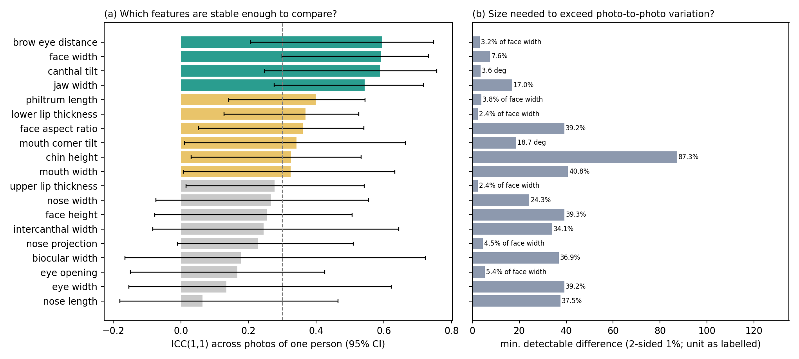
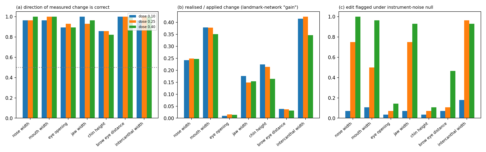
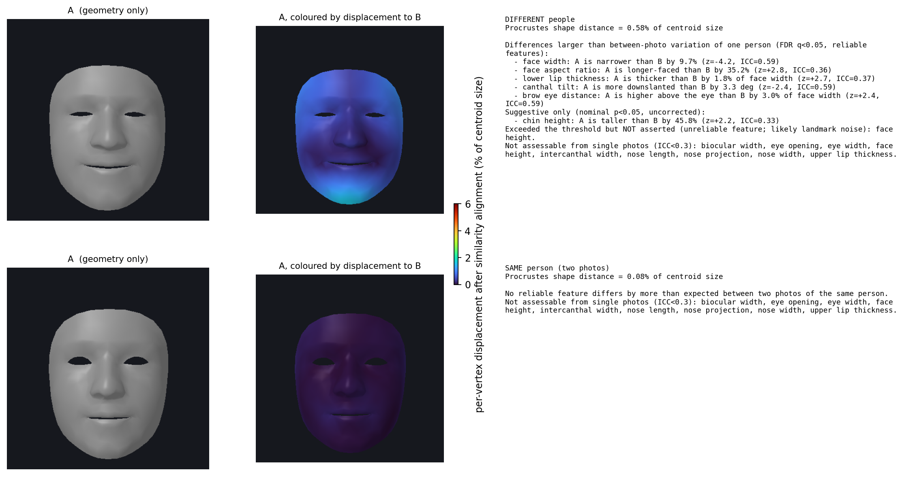

# Calibrated, Reliability-Aware Feature Attribution for Monocular 3D Face Differences: A Pilot Study

*Draft for the GECO-Enhanced repository. All numbers are produced by the scripts in `scripts/eval/` and stored in `docs/results/`. This is a pilot-scale study (13 identities); see Section 7 before drawing conclusions.*

## Abstract

Explaining *which* facial feature differs between two photographs, and *by how much*, is attractive for forensic review, medical morphometrics and interpretable face verification, but any such explanation is only as good as the stability of the underlying measurements. We build a pipeline that (i) recovers a pose-normalised 468-vertex 3D face from one photograph using a landmark network with test-time averaging, (ii) measures 19 scale-free anthropometric features, and (iii) compares two faces feature by feature against an empirical model of the variation a single person shows between different photographs, with heavy-tailed (Student-t) calibration, Benjamini-Hochberg false-discovery control and an explicit reliability floor. On 61 photographs of 13 identities, test-retest reliability is limited: only four features reach ICC ≥ 0.5 (face width, canthal tilt, brow-to-eye distance, jaw width) and nine of 19 fall below 0.30 and are never asserted. A Gaussian noise model over-flags same-person pairs by roughly 9x at the nominal 1% level; the Student-t model restores calibration (1.1-2.2%). As a verification score the geometry reaches AUC 0.71 on 280 labelled pairs, comparable to one deep model (DeepFace 0.74) and far below others (VGG-Face 0.99). In 588 controlled image edits the measured change had the correct direction 95.2% of the time, but the network recovers only a fraction of an applied deformation (gain 0.01-0.40) and single-feature attribution is confounded by shared normalisation. We therefore claim calibrated, conservative explanations for a small set of reliable features, not general feature-level attribution.

## 1. Introduction

Deep face-verification models answer "same person?" but not "why not?". Landmark geometry offers an interpretable alternative, yet single-photo measurements are contaminated by expression, pose, lighting, makeup and landmark-detector noise. A system that states "A's nose is 8% wider than B's" without knowing that the same person's nose-width estimate varies by 25% between photographs is making an unsupported claim. This work asks three questions: **(Q1)** which anthropometric features are stable enough across photographs to be compared; **(Q2)** how large must a difference be before it exceeds within-person variation, with controlled false-positive rate; **(Q3)** when a known geometric change is applied, does the pipeline recover the right feature and direction?

**Contributions.** (1) A pose-normalised, test-time-averaged landmark pipeline with a mirror-aware landmark permutation derived from the canonical mesh. (2) A within-person noise model (Student-t, leave-identity-out) with BH correction and a reliability floor so unreliable features are reported as "not assessable". (3) A reliability audit (ICC with identity-cluster bootstrap) and minimum-detectable-difference table. (4) A controlled-edit recovery experiment with known ground truth, evaluated under two null models. (5) Open code and data-format-compatible evaluation scripts.

## 2. Related work

Dense monocular face reconstruction follows 3D morphable models (Blanz & Vetter 1999; FLAME, Li et al. 2017) and learned regressors such as DECA (Feng et al. 2021). Real-time landmark meshes, as used here, come from MediaPipe Face Mesh (Kartynnik et al. 2019). Deep verification (ArcFace, Deng et al. 2019; the models wrapped by `deepface`, Serengil & Ozpinar 2020) is accurate but opaque. Classical craniofacial anthropometry (Farkas 1994) defines the measurements we adapt; geometric morphometrics (Dryden & Mardia 2016) motivates centroid-size normalisation and Procrustes alignment (Umeyama 1991). Reliability follows Shrout & Fleiss (1979) and multiplicity control Benjamini & Hochberg (1995).

## 3. Method

**3.1 Reconstruction.** YuNet detects the face; the MediaPipe `face_landmark` network (192x192 input) predicts 468 (x, y, z) landmarks. We average 16 passes with random scale (1.4-1.6x), shift (±4% of box), in-plane rotation (±6°) and horizontal flips. Flipped passes are mapped back with a mirror permutation computed from the canonical mesh (verified an involution with maximum vertex error < 5e-3). A similarity (Umeyama) fit to the canonical mesh gives pose, and the inverse yields a frontal, person-specific shape. z is the network's learned depth estimate, not a measurement.

**3.2 Features.** 19 features (Table 1): widths, heights, angles and a depth feature (nose projection). Shapes are divided by centroid size. Large quantities are compared as log-ratios; small ones (eye opening, lip thickness, philtrum, brow-eye distance, nose projection) as a fraction of mean face width, because ratios of few-pixel quantities have enormous variance. Face height uses nasion-to-chin because forehead-top landmark 10 depends on hair.

**3.3 Noise model and significance.** For every pair of photographs of the same person we compute the difference vector d. Per feature we fit a zero-mean Student-t (df and scale by maximum likelihood) to ±d, leave-identity-out: the model used to test a pair never sees either identity. p-values are two-sided; BH controls FDR across the 19 features (q = 0.05). A feature is **asserted** only if it is significant and its ICC ≥ 0.30; significant-but-unreliable features are reported as likely landmark noise; features with nominal p < 0.05 but no FDR significance are "suggestive". Output sentences give direction and size ("A is 9.7% narrower than B").

**3.4 Difference map.** After similarity alignment (Procrustes) the per-vertex displacement, in % of centroid size, is shown on a neutral, texture-free mesh.

## 4. Experimental protocol

**Data.** The `deepface` unit-test set: 61 photographs of 13 public figures (identities = connected components of "same" labels; no label conflicts), 280 labelled pairs with embedding distances for four models and a second list of 300 pairs. All faces are shown only as geometry-only renders. Pose gating (|yaw| ≤ 15°, |pitch| ≤ 18°) removes 4 images (57 remain).

**E1 reliability.** ICC(1,1), one-way random, unbalanced groups; 95% CI by identity-cluster bootstrap (300 resamples). **E2 calibration.** Same-person false-positive rates for held-out identities. **E3 discrimination.** AUC of the RMS-z score over features on the 280 pivot pairs vs the four deep distances (like-for-like). **E4 controlled edits.** Seven Gaussian-weighted local warps (nose width, mouth width, eye opening, jaw width, chin height, brow height, intercanthal width), two signs, doses 0.10/0.25/0.40, 14 near-frontal sources (13 identities): 588 edits plus 56 benign controls (JPEG q60, 0.6x resize, brightness 0.75, blur σ=2). Edits are judged under two nulls: the **within-person null** (Section 3.3) and an **instrument-noise null** fitted on the controls of *other* source images (cross-fitted).

## 5. Results

### 5.1 Reliability and detectability (Table 1)

| Feature | ICC(1,1) [95% CI] | Min. detectable difference (2-sided 1%) | Reportable (ICC ≥ 0.30) |
|---|---|---|---|
| brow eye distance | 0.59 [0.21, 0.75] | 3.2% of face width | yes |
| face width | 0.59 [0.30, 0.73] | 7.6% | yes |
| canthal tilt | 0.59 [0.25, 0.76] | 3.6 deg | yes |
| jaw width | 0.54 [0.28, 0.72] | 17.0% | yes |
| philtrum length | 0.40 [0.14, 0.54] | 3.8% of face width | yes |
| lower lip thickness | 0.37 [0.13, 0.53] | 2.4% of face width | yes |
| face aspect ratio | 0.36 [0.05, 0.54] | 39.2% | yes |
| mouth corner tilt | 0.34 [0.01, 0.66] | 18.7 deg | yes |
| chin height | 0.33 [0.03, 0.53] | 87.3% | yes |
| mouth width | 0.32 [0.01, 0.63] | 40.8% | yes |
| upper lip thickness | 0.28 [0.02, 0.54] | 2.4% of face width | no |
| nose width | 0.27 [-0.07, 0.55] | 24.3% | no |
| face height | 0.25 [-0.08, 0.51] | 39.3% | no |
| intercanthal width | 0.24 [-0.08, 0.64] | 34.1% | no |
| nose projection | 0.23 [-0.01, 0.51] | 4.5% of face width | no |
| biocular width | 0.18 [-0.17, 0.72] | 36.9% | no |
| eye opening | 0.17 [-0.15, 0.43] | 5.4% of face width | no |
| eye width | 0.13 [-0.15, 0.62] | 39.2% | no |
| nose length | 0.06 [-0.18, 0.46] | 37.5% | no |

Only four features exceed ICC 0.5 and their confidence intervals are wide (13 identities). Fine structure (eye opening, eye width, nose length, nose width) is not stable across photographs at this resolution. Figure 1 plots both columns.



### 5.2 Calibration and ablation (Table 2)

| Pose gate | Averaging | Noise model | Images | Same-person FPR @1% | Same pairs ≥1 flag | Different pairs ≥1 flag | AUC (rms-z) | Mean ICC |
|---|---|---|---|---|---|---|---|---|
| none | none | Gaussian | 61 | 7.6% | 35.7% | 51.6% | 0.658 | 0.241 |
| none | none | Student-t | 61 | 1.8% | 9.3% | 16.5% | 0.666 | 0.241 |
| none | 16 jitters+flip | Gaussian | 61 | 10.0% | 39.3% | 62.1% | 0.665 | 0.261 |
| none | 16 jitters+flip | Student-t | 61 | 1.1% | 4.3% | 12.5% | 0.685 | 0.261 |
| |yaw|≤15°, |pitch|≤18° | none | Gaussian | 58 | 6.8% | 30.6% | 55.6% | 0.698 | 0.306 |
| |yaw|≤15°, |pitch|≤18° | none | Student-t | 58 | 2.2% | 14.5% | 19.9% | 0.717 | 0.306 |
| |yaw|≤15°, |pitch|≤18° | 16 jitters+flip | Gaussian | 57 | 9.1% | 34.5% | 67.5% | 0.701 | 0.329 |
| |yaw|≤15°, |pitch|≤18° | 16 jitters+flip | Student-t | 57 | 2.2% | 10.9% | 17.3% | 0.725 | 0.329 |


Averaging crops raises mean reliability slightly (0.241 → 0.261 ungated, 0.306 → 0.329 gated). Heavy tails dominate the calibration problem: with a Gaussian model 7.6-10.0% of held-out same-person feature differences exceed the nominal 1% threshold (6.8-9.1% gated); the Student-t model gives 1.1-2.2%. Pose gating raises AUC and reliability but removes images. Pair-level "any flag" rates for different persons remain low (12.5-19.9% with t), i.e. most true person-to-person differences are *not* distinguishable from photo-to-photo variation.

### 5.3 Discrimination

On the 280 labelled pivot pairs (140 same, 140 different) the geometry score has AUC 0.714 (95% CI 0.648-0.777); after pose gating (237 pairs) 0.750 (0.679-0.811). Baselines on the same pairs: DeepFace 0.743 (0.733 gated), OpenFace 0.819 (0.804), VGG-Face 0.991 (0.989), Facenet 1.000. Geometry is therefore a weak identity cue, on a par with the weakest deep model, and is not proposed as a verifier.

### 5.4 Controlled edits

Across 588 edits the sign of the measured change matched the intended sign 95.2% of the time (95% CI 93.5-97.0%; 96.1% among the 233 detected edits). Controls produced no flags under the within-person null; under the instrument null 7.1% of controls triggered at least one flag.

| Edit | Direction correct | Gain (realised/applied) | Detected, instrument null (dose 0.25 / 0.40) | Off-target flags per edit (dose 0.25) | Detected, within-person null (dose 0.40) |
|---|---|---|---|---|---|
| nose width | 0.98 | 0.25 | 0.75 / 1.00 | 8.2 | 0.00 |
| mouth width | 0.99 | 0.37 | 0.50 / 0.96 | 5.1 | 0.00 |
| intercanthal width | 0.99 | 0.40 | 0.96 / 0.93 | 9.9 | 0.04 |
| jaw width | 0.96 | 0.16 | 0.75 / 0.93 | 7.1 | 0.00 |
| chin height | 0.85 | 0.20 | 0.07 / 0.11 | 0.9 | 0.00 |
| brow-eye distance | 1.00 | 0.04 | 0.11 / 0.46 | 1.5 | 0.00 |
| eye opening | 0.90 | 0.01 | 0.07 / 0.14 | 1.2 | 0.00 |

Three conclusions. (i) **Direction** is dependable even when magnitude is not. (ii) **Magnitude is attenuated**: the landmark network regularises toward plausible faces, so applied warps are under-recovered (eye opening and brow height almost not at all). (iii) **Attribution is confounded**: edits that are detectable also change several other features (5-10 flags), and the largest-|z| feature lies in the edit's coupled set only 0-32% of the time at dose 0.40. Under the realistic within-person null no edit up to a 40% local warp is flagged, consistent with Table 1: real person-to-person differences must be large to be asserted.



### 5.5 Qualitative output

Figure 3 shows the explanation for a different-person pair (selected as the pair with the most asserted reliable features; a best case, not a typical one) and for a same-person pair, on geometry-only meshes.



## 6. Discussion

The principal finding is negative-but-useful: with a 192-pixel landmark network and single photographs, only coarse, high-reliability features can be compared, and only differences above the per-feature thresholds in Table 1 can be asserted against the variation a person shows between photographs: roughly 3-17% for the four most reliable features, and far more (24-87%) for most others. Our pipeline abstains explicitly instead of naming a feature when the evidence is insufficient. The reliability and detectability tables give users the information needed to interpret any such report, which we consider the paper's main practical contribution.

## 7. Limitations and threats to validity

1. **Scale.** 13 identities, 61 images, public-figure photographs with uncontrolled expression, age, makeup and lighting; confidence intervals on ICC are wide. 2. **No 3D ground truth.** Depth comes from the network's prior; the closed-loop and edit experiments test self-consistency and sensitivity, not metric accuracy. 3. **Circularity risks.** The noise model and ICC are estimated on the same pilot set (leave-identity-out for calibration, but reliability tiers are not cross-validated). 4. **Edits are 2D warps**, not anatomical changes, and are partly attenuated by the network. 5. **Attribution confounding** from centroid-size normalisation and anatomical correlation is not solved. 6. **Pose gating** reduces coverage. 7. **Fairness.** Landmark networks and reliability may vary across demographics; no subgroup analysis was possible. 8. The reconstructed shape is not a metrically accurate scan and should not be used for clinical or forensic decisions.

## 8. Reproducibility

```bash
pip install ai-edge-litert opencv-python scipy numpy pillow matplotlib
python scripts/extract_mediapipe_models.py
D=path/to/deepface/tests/unit/dataset
PYTHONPATH=src python scripts/eval/evaluate_face_diff.py --images $D --pairs $D/face-recognition-pivot.csv $D/master.csv --out results --tta 16 --noise t --max-yaw 15 --max-pitch 18
PYTHONPATH=src python scripts/eval/evaluate_face_edits.py --images $D --pairs $D/face-recognition-pivot.csv $D/master.csv --out results --shapes results/shapes_tta16.pkl
PYTHONPATH=src python scripts/eval/evaluate_pivot_auc.py --pairs $D/face-recognition-pivot.csv $D/master.csv --pivot $D/face-recognition-pivot.csv --shapes results/shapes_tta16.pkl
PYTHONPATH=src python scripts/eval/make_face_diff_figures.py --results results --pairs $D/face-recognition-pivot.csv $D/master.csv --shapes results/shapes_tta16.pkl --out docs/figures
```

## 9. What would make this submission-ready

A benchmark with many identities and several controlled photographs each (e.g. LFW/CelebA subsets or a multi-view set), 3D scans for metric ground truth (e.g. BU-3DFE, FaceScape), multi-photo fusion per person, a decorrelated attribution method, higher-resolution landmark inputs, subgroup analysis, and pre-registration of the reliability threshold.

## References (verify before submission)

Benjamini & Hochberg (1995), *J. R. Stat. Soc. B*. Blanz & Vetter (1999), *SIGGRAPH*. Deng et al. (2019), ArcFace, *CVPR*. Dryden & Mardia (2016), *Statistical Shape Analysis*, Wiley. Farkas (1994), *Anthropometry of the Head and Face*, Raven. Feng et al. (2021), DECA, *SIGGRAPH*. Kartynnik et al. (2019), Real-time facial surface geometry from monocular video on mobile GPUs, *CVPR Workshops*. Li et al. (2017), FLAME, *SIGGRAPH Asia*. Serengil & Ozpinar (2020), LightFace, *ASYU*. Shrout & Fleiss (1979), *Psychol. Bull.* Umeyama (1991), *IEEE TPAMI*.
